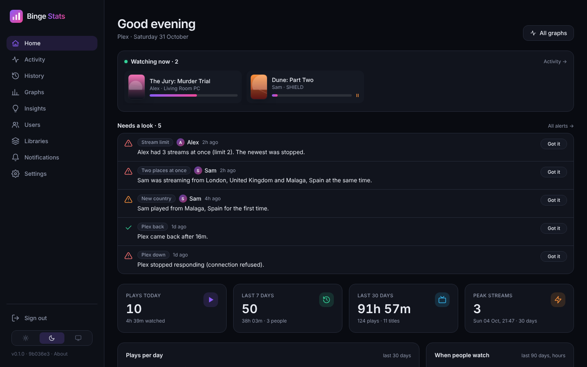
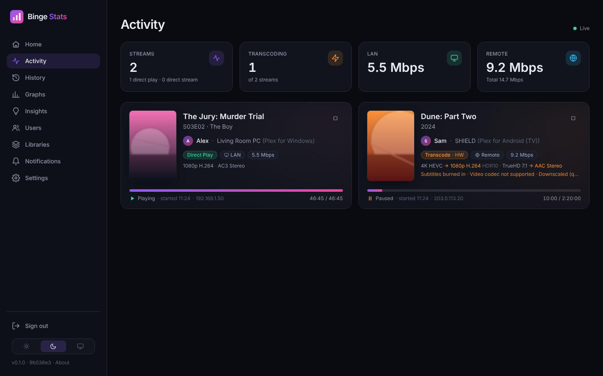
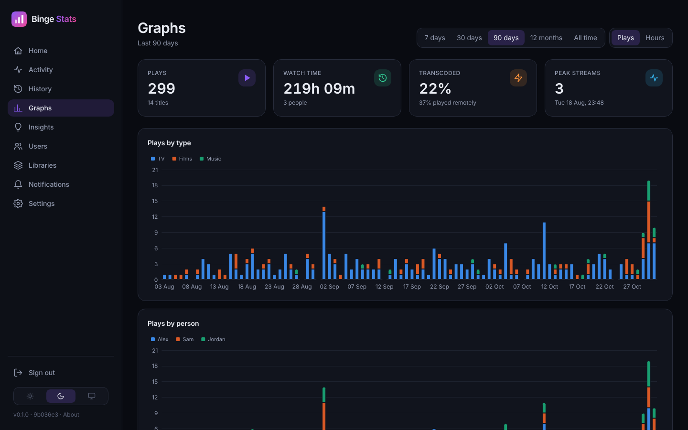
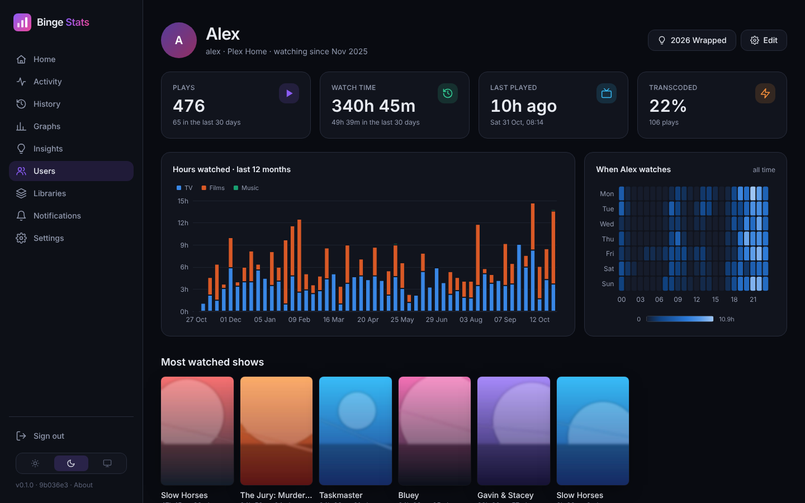
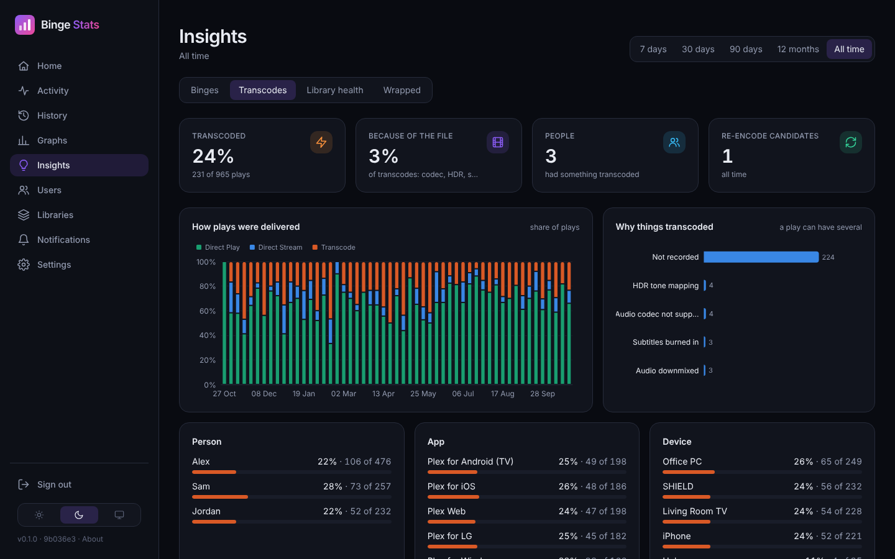
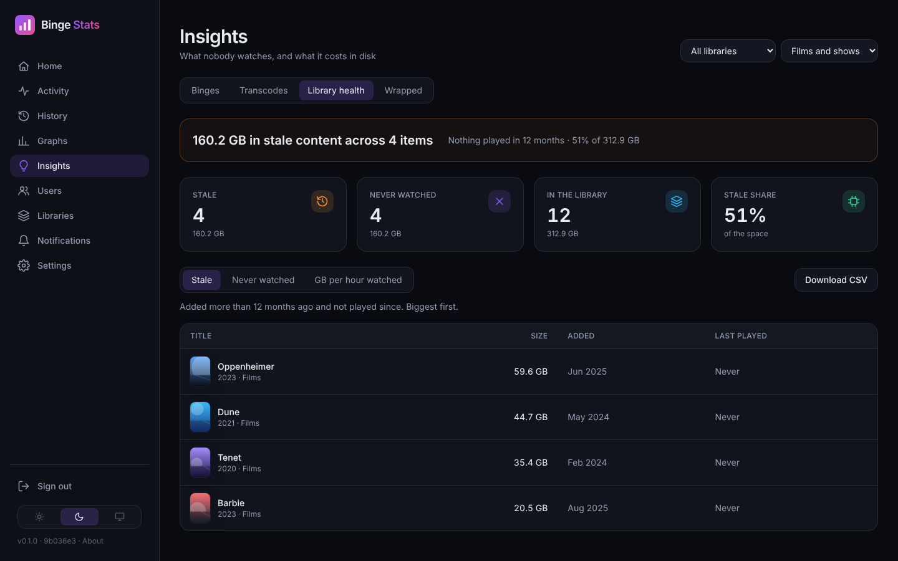
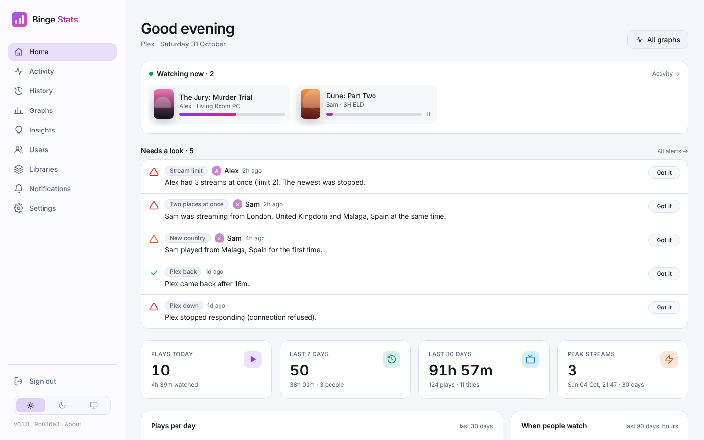
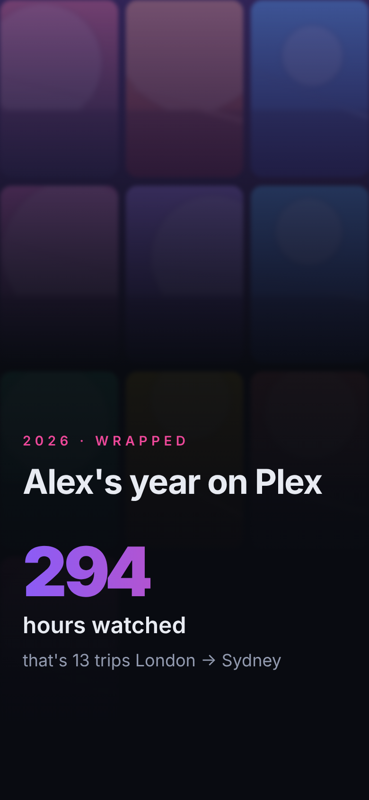

# Binge Stats

Self-hosted Plex monitoring and statistics: a modern take on Tautulli. Live activity, full history, graphs, notifications through Apprise and Home Assistant over MQTT. It also does things Tautulli doesn't: binge and series-completion tracking, transcode analysis, library health, account-sharing alerts and a shareable year in review.



## What it does

- **Live activity:** every stream with quality, the direct play / transcode decision and the reason for it, bandwidth, LAN or remote, and a stop button with a message.
- **History:** every play, filterable and exportable to CSV. Resumed plays are grouped into one.
- **Tautulli import:** years of history carried over, with a dry run first. It's safe to run more than once.
- **Graphs and stats:**
  - plays and watch time over time, by day and hour;
  - by app, device, library and stream type;
  - top people, shows and films, and the most streams at once.
- **People:** watch time, favourite content, devices, where they watch from on a map, and a viewing heatmap.
- **Insights:**
  - binges, plus shows in progress, finished and given up on;
  - why things transcode and which files to re-encode;
  - library health: stale and never-watched content, and GB per hour watched, with CSV.
  - the collection: codecs, resolutions, how much a re-encode would free (nothing deleted), what to upgrade, and gaps in shows;
  - playback problems: who buffers, on which device and from where.
- **Sonarr, Radarr and SABnzbd (optional, read-only):** a live downloads queue showing the show, episode or film each NZB is (not its file name), which you can reorder by dragging if you turn that on, real gaps in shows, film collections, what's below your quality cutoff, what's airing this week and your download history.
- **Wrapped:** a year in review per person and for the whole server. It's built for a phone, shared with a signed link you can revoke, and prints as one page.
- **Notifications:** rules (trigger → conditions → message → channels) to Discord, Telegram, ntfy, Pushover, email and the rest through Apprise. A season drop sends one "recently added" digest.
- **Stream rules:** per-person stream and transcode limits that alert, or stop the newest stream. Alerts for one account playing from two places at once, or from a new country.
- **Home Assistant:** MQTT discovery for stream counts, bandwidth, Plex status, a "now watching" sensor and a "stop streams" button per person.
- **Logins for your people:** give someone a password from their user page. They sign in with their Plex username and see only their own stats, history and Wrapped.
- **For screens and automations:** an API built to the homelab API standard: a one-glance status, feeds (now playing, just arrived, history, downloads, pins), resized artwork, a few safe actions (pin, unpin, clear alerts), a live events stream, signed webhooks for Home Assistant and n8n, and a full-screen "now playing" page for a kiosk or Vital Signs. Tokens are read-only or read-write, and a read token can go in the URL for a display. See [docs/API.md](docs/API.md).
- **The rest:** nightly backups, and dark, light or system themes.

| | |
|---|---|
|  |  |
|  |  |
|  |  |

<p align="center"></p>

*Screenshots use made-up people and generated artwork.*

## Install

You need Docker with Compose, and a Plex Media Server you own. Binge Stats is run by the server's admin; the admin can also give the people on the server a login to see their own stats.

```bash
mkdir binge-stats && cd binge-stats
curl -fsSL -o docker-compose.yml https://raw.githubusercontent.com/marctew/Binge-Stats/HEAD/docker/docker-compose.ghcr.yml
docker compose up -d
```

1. Open `http://<host>:8181` and create your admin login.
2. **Sign in with Plex**, or paste a server URL and token. Binge Stats keeps the token on the server and never sends it to your browser.
3. On the next screen your libraries and users sync on their own. Anything played from then on is recorded live.
4. Coming from Tautulli? See below. Years of history take a couple of minutes.

Set `TZ`, `PUID` and `PGID` in the compose file to suit. `API_PUBLIC: "0"` makes the API refuse anything that came through a Cloudflare tunnel, so it only answers on the LAN. Everything lives in `./data`: the database, backups, the image cache and `config.toml` (which holds the secret key).

**Updating:**

```bash
docker compose pull && docker compose up -d
```

The image is built for amd64 and arm64.

### Importing from Tautulli

1. Copy `tautulli.db` into `data/import/`, or mount Tautulli's data folder read-only at `/import` in the worker (commented out in the compose file).
2. Open **Settings → Import from Tautulli**. Check first, then import.

Tautulli can keep running while you do this. Running the import again later picks up anything Tautulli recorded in the meantime: nothing is imported twice, and plays Binge Stats recorded live are skipped. The file holds your users' Plex tokens, so delete the copy when you're done.

### Publishing it

Binge Stats works behind a reverse proxy or a Cloudflare Tunnel at `/`. Set **Settings → Public URL for share links** to the public address, so Wrapped links work outside your network.

The admin pages are behind your login. For extra safety, put something like Cloudflare Access in front, and let `/wrapped/s/` bypass it so shared links still open.

### Backups

The database is backed up every night at 03:30 (your `TZ`) to `data/backups/`, keeping the last 7. **Settings → Backups** has *Back up now* and downloads.

To restore:
1. Stop the containers.
2. Copy a backup over `data/bingestats.db`, and delete `bingestats.db-wal` and `bingestats.db-shm` if they're there.
3. Start the containers again.

## Building it yourself

```bash
git clone https://github.com/marctew/Binge-Stats && cd Binge-Stats
GIT_SHA=$(git rev-parse --short HEAD) docker compose up -d --build
```

`scripts/update.sh` pulls, rebuilds and waits for the health check. It works from anywhere, run as root or as the repo's owner. To make it one word:

```bash
sudo ln -sf /opt/binge-stats/scripts/update.sh /usr/local/bin/binge-update
```

## Development

```bash
python3 -m venv .venv && .venv/bin/pip install -r requirements-dev.txt
scripts/build-css.sh                                    # fetches pinned htmx/Alpine/ECharts/Tailwind, builds the CSS
DATA_DIR=./data .venv/bin/python -m bingestats web --dev
DATA_DIR=./data .venv/bin/python -m bingestats worker  # second shell
.venv/bin/python -m pytest
```

The home screen icons (`bingestats/static/apple-touch-icon.png`, `icon-192.png`, `icon-512.png`, `favicon.ico`) are made from `bingestats/static/brand/logo.svg` by `python tools/make_icons.py bingestats/static` (needs `cairosvg` and Pillow; Design Uniformity `PWA-ICONS.md`). Commit the results.

**Stack:**
- Python 3.12, Flask and plain SQLite.
- Jinja, HTMX, Alpine.js, Tailwind (standalone CLI, no Node) and ECharts.
- Front-end assets are pinned by version and sha256, and fetched at build time. Nothing loads from a CDN.

**Docs:**
- [DESIGN.md](DESIGN.md) records the decisions.
- [SPEC.md](SPEC.md) is the build spec.
- [docs/API.md](docs/API.md) is the whole API; `python3 scripts/check_api.py <url> <token>` checks a running copy against the standard.
- [docs/verification.md](docs/verification.md) is what's been checked against a real server.

**CI** runs the tests on every push and publishes `ghcr.io/marctew/binge-stats` from the default branch and from `v*` tags.

## Credits

Built with Flask, HTMX, Alpine.js, Tailwind CSS, [Apache ECharts](https://echarts.apache.org), [Leaflet](https://leafletjs.com) with [OpenStreetMap](https://www.openstreetmap.org/copyright) tiles, [Apprise](https://github.com/caronc/apprise) and paho-mqtt. IP locations are by [DB-IP](https://db-ip.com) (CC BY 4.0).

Not affiliated with Plex Inc.
